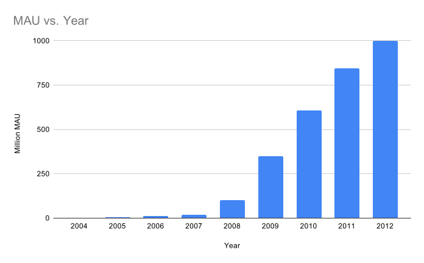

<!-- _class: title -->
# Test engineering

---
## You know testing

The test pyramid

- Unit testing
- Component testing
- End to end testing

<!--
You know you need to do unit testing first, component testing later, and finally end to end testing.
-->

Many tools...

- Manual testing
- Regression testing
- Mutation and fuzz testing
- Coverage analysis

<!--
There are many ways to build your testing story incrementally.

Yes, Manual testing is a thing. Not all tests are automated.

You are ALLOWED to verify manually that your changes work.
-->

---
## You known the sins of testing

- Your tests catch bugs early
- Your tests test features, not implementations
- Your tests do not fail when you fix a bug
- Your write a test that fails before fixing a bug

<!--
Most importantly, you know that what matters is that you build tests that test features, not implementations.

i.e., if you fix a bug, you should add a regression test but the existing tests should not be impacted by the bug fix

So, you do all this, you feel pretty good. But...
-->

---
## But

Do you know why they pay you to do testing ?

- To improve Quality ?
- To ship faster ?
- To ship more features ?
- To find and fix bugs ?

No one ever pays for tests:

- You are getting $$$ so your employer makes $$$

<!--
Customers, Managers are paying for something they can use or sell.

Tests are not REQUIRED for this.

Maybe manual tests are cheaper to do once than automated tests are to build.

Maybe you can use the system even if it's buggy.

Maybe you are not willing to pay the extra cost to get the bugs fixed

Maybe you can afford to offload the cost to fix the bugs to someone else

Maybe the product must absolutely work bug-free on day #1

It really depends on how your employer makes $$$

-->

---
## Test engineering

It's about finding a working compromise among 3 dimensions

- Cost
- Time
- Quality

Now, let's look at a few examples

---
## Ex.1: Free TV over ADSL (2003)

0 to 1M subscribers in 2 years

They were

- First to market
- Cheap
- Every feature possible

<!--
In 2002, ADSL started to appear on the market. Most customers were on 58K dialup modems. TV over ADSL did not exist. People used antennas on roofs :)
-->

---
## How would you do it ?

<!--

How would you build your test strategy to become the first to market, the cheapest, and with every single feature every human could want ?

-->

---
## How Free did it

Technology

- They shipped code that did not work/was not tested
- They gamified testing and debugging by customers (Freenautes)
- They shipped updates every week

No real testing in a traditional sense

But a strategy to build a successful product

<!--

Yes, their customers were happy to pay to do testing for them !?!

-->

---
## Ex.2: Move Fast and Break Things

<!--

Facebook is known for generating the prototypical startup exponential curve but also for Zuck's moto: "Move Fast and Break Things".

Another one: "If you are not breaking things, you are not moving fast enough".

Speed of execution, being first to market are considered the most important feature of any feature.

Some say that it's because of this approach that they achieved the exponential curve.

-->

---
## How would you do it ?

<!--

How can you survive this speed ?

How can you sustain it for so long ?

How can you make sure the system does not implode under its own weight ?

-->

---
## How Facebook did it

1. Write code
2. Test in staging
3. Deploy code in production with feature toggle
4. Deploy: enable feature toggle for New Zealand
5. Monitor engagement metrics
6. Rollback: disable feature toggle if needed

<!--
New Zealand is 1M english-speaking users. They would get a lot of experimental features first because they were cheap guinea pigs, big-enough to give meaningful results, small-enough that you could afford to screw them.
-->

It worked because of culture, ownership

<!--

Strong alignment between company objectives: move fast, achieve the best MAU/engagement numbers for IPO because a lot of employees owned equity pre-IPO.

-->

---
## Ex.3: NASA JPL Opportunity

Autonomous driving

- Extreme daily temp variations: -120 to +20
- High latency: 6 to 44mins RTT
- Extreme longevity: 57x over planned

<!--

Designed in 2000-2002

Built in 2001-2003

Launched in 2003

Landed in 2004

Roved until 2018

20 MHz CPU with 128 MB of DRAM and 3 MB of EEPROM

140W/h for 14h from solar arrays

Autonomous driving !!!
-->

---
## How would you do it ?

---
## How JPL did it

- Strict coding style limitations (no loops, etc.)
- 6 major software updates
- 1 flash reformat
- Minor hot code patches
- Component and system-level simulation 
- Earth component and system-level testbed manual tests
- Progressive in-the-field manual tests

<!--

Super rigorous testing bottom up

Most importantly: reliable remote system updates 225M km away
-->

---
## A successful testing strategy

Must add value given its cost

Fits in a global culture

- Development
- Customer relationship
- Cost of failure in the field
- Delay to deploy and rollback

ONE TAKEAWAY: Be mindful of how you fit in this

---
## Extra material

- [Development at Facebook](https://launchdarkly.com/blog/secret-to-facebooks-hacker-engineering-culture)
- [Kent Beck about his time at Facebook](https://youtu.be/ddHQQtjIOpw?t=6289)
- [The power of ten](https://en.wikipedia.org/wiki/The_Power_of_10:_Rules_for_Developing_Safety-Critical_Code)
